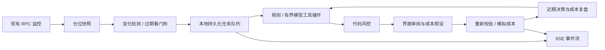

# 事件驱动 LP 策略 Agent

此控制台现位于策略页底部的“高级：事件观察与成本演练”。默认入口已改为[地址查仓与按需 AI 分析](wallet-agent.md)，两条链路独立：查仓不会自动导入监控，按需 Codex 分析不会复用本页事件队列或自动模拟。

这个版本在 LP Sentinel 的本地 Express 进程中运行，复用现有 NFT 来源和 JSON 存储。它完成「事件 → 策略分析 → 风控 → 成本模拟 → 复盘记忆」闭环，不签名、不广播交易，也不替换原有钱包流程。

## 运行

```sh
npm run dev
```

打开 http://127.0.0.1:1422，选择左侧「策略 Agent」。点击「运行越界演练」即可用合成 ETH / USDC 数据生成建议；Gas 1 USDC、滑点 10 bps 是演练假设，不是市场报价。点击「模拟这次操作」后查看成本与复盘。合成行情固定在事件发生时刻，30 秒后需重新运行演练，已完成的演练也遵守冷却期。

已导入的 Robinhood / Uniswap V3、BNB / PancakeSwap V3、Base / Uniswap V3 仓位会自动进入事件观察。首次观察、区间状态变化、相对上次触发价格变化达到 1%、行情不可用，以及手动评估都会生成任务。接近边界采用已有预警线，区间外优先使用链上 tick 的半开区间判断。

## 界面交互

- 事件流更新时保留当前选中的计划，不因后台新增决策自动跳转；当前记录不再保留时回到最新计划。主动评估或运行演练后，结果生成时自动选中本次计划；等待期间暂停当前计划的模拟提交。手动选择其他记录会取消这次自动跳转。
- Gas 与滑点假设绑定当前计划，切换计划时重置，避免把上一条计划的成本带入另一条。新生成的演练计划预填 Gas 1、滑点 10 bps；真实仓位计划和手动切换的历史计划需重新填写。
- 事件记录显示排队、分析、完成与失败状态，决策轨迹与当前计划对应；重启恢复的任务会留下「恢复任务」轨迹。事件流重连后读取当前会话快照。
- 窄屏下决策与事件记录纵向排列，操作按钮保留完整文字并允许换行，点击区域至少高 44px；不缩为只有图标的按钮。

## 架构



这里的事件来自 RPC 轮询快照的变化检测；不是直接订阅链上 WebSocket 日志。监控完成时唤醒检测器，5 秒看门狗负责发现数据过期。策略只在事件出现时运行，不会每次轮询都调用模型。单进程串行处理任务，同一观察状态去重；手动重复请求复用在途任务。

持久化记录包含事件身份、快照、处理状态、工具使用摘要、策略候选、风控结果及模拟复盘。重启后恢复 `processing` 任务，最多尝试 3 次；普通模型失败标记为失败，用户可重新评估。模拟结果与冷却状态在同一次 JSON 原子替换中提交，同一计划重复模拟返回原结果。JSON Store 在写盘成功后才发布内存状态，写盘失败不会留下未持久化的成功状态。

## 模型与工具

默认 `rules` 模式无需 API Key，并明确标记为规则判断。启用模型时：

1. 复制 `.env.example` 为 `.env`，填写 `AI_GATEWAY_API_KEY` 和 `LP_AGENT_MODEL`。不要提交凭据。
2. 使用 `node --env-file=.env --import tsx server/index.ts` 启动后端，另开终端运行 `npx vite`。普通 `npm run dev` 不自动读取 `.env` 到后端，也可在 shell 中预设这些变量。
3. 在 Agent 的「策略设置与执行边界」切换「模型工具模式」。开启前界面会说明哪些数据将发送给模型服务。

模型通过 AI Gateway 的 Chat Completions 工具调用接口运行，最多 4 轮、整次调用超时 25 秒。工具只有 `get_market_context`、`compare_strategies`、`get_recent_decisions` 和 `submit_plan`。提交前必须读取行情与策略候选，返回动作与理由经过本地校验。模型不能调用任意 URL、Shell、钱包或修改风险阈值。失效行情直接进入规则拦截流程；有效行情的模型调用失败会显式失败，不伪装成模型成功。

决策记忆是最近 5 条同仓位建议及成本复盘，不是训练模型或经过收益验证的自我优化。

独立的 [历史研究流程](lp-research.md) 支持 30 天 Ethereum V3 小时数据、规则参数校准和隔离测试。它不调用模型、不使用实时 Agent 的一小时采样代替月度数据，也不自动将离线候选应用到监控仓位；小时手续费仍为近似估算。

## 风控与模拟口径

- 30 秒快照时效、异常/暂停/缺失阻断；新旧区块回退拦截。通知失败与行情读取失败分开，DWS 未登录不阻止对有效行情的分析。
- 默认同仓位冷却 15 分钟、成本上限 30 bps、价格偏移上限 100 bps。计划最长保留可执行资格 2 分钟，执行仍要求最新快照有效。
- 模拟前重新读取本地最新监控快照，检查价格、原区间、区间状态、仓位存在与启用状态、区块和当前策略设置。
- 成本估算 = 用户输入的 Gas 报价币金额 + 本金 × 滑点 bps / 10000。为保守起见，滑点假设作用于全部本金，不声称等于实际换币成交额。
- 参考本金 = 当前本金 − 估算成本，不包含未来价格、手续费、无常损失、MEV 或收益预测。没有虚构 APR、收益率或交易哈希。
- 重新居中只提供价格参考区间，保留原相对宽度并限制半宽度在 2%–40%；没有进行协议 tick 对齐、报价、换币路由、链上预执行或签名。
- 双币移除不等同于换成稳定币，不会消除持币价格风险。

## API

| 方法 | 路径 | 行为 |
| --- | --- | --- |
| GET | `/api/agent` | 配置、最近事件与计划、模型是否已配置 |
| GET | `/api/agent/stream` | SSE `state` 事件，重连时发送当前快照 |
| PATCH | `/api/agent/policy` | 部分更新 enabled / planner / cooldownSeconds / maxCostBps / maxPriceDriftBps |
| POST | `/api/agent/review/:positionId` | 评估已有仓位，JSON `{}` |
| POST | `/api/agent/demo` | 独立合成事件，JSON `{}` |
| POST | `/api/agent/plans/:planId/simulate` | `{ "gasQuote": 1, "slippageBps": 10 }` |

所有写请求要求 JSON，拒绝跨站 Origin。服务仍仅绑定 `127.0.0.1`，没有多用户鉴权；不要直接暴露到公网。设置 `LP_SENTINEL_DATA_FILE` 可使用独立演练数据，默认沿用 `data/lp-sentinel.json`。

## 本次验证范围

生产构建已通过。已完成 Agent、JsonStore、monitor 与 Express routes 的无端口进程内集成演练，覆盖事件去重、成本与冷却、过期行情、RPC 失败、区块回退、DWS 失败隔离、模拟模型工具循环、禁止工具与无效输出、写盘失败回滚及重启恢复。未新增业务单测。

最终 `npm test` 为 64 项通过、1 项失败：`static-fallback` 因 `listen EPERM` 无法监听端口，与改动前基线一致，不能据此声称全套测试通过。`npm run build` 通过，仍有入口 bundle 超过 500 KB 的提示。未调用真实模型、RPC 或钱包，未发送通知。浏览器 host 不可用且 Chrome 工具未获授权，未取得桌面或手机截图；上述响应式行为仅经过代码核对，尚未完成浏览器视觉与交互验收。

独立收尾审阅的最终结论为「R1–R4 代码复核均已解决」，视觉验收未验证：

| 项目 | 最终状态 |
| --- | --- |
| R1 手机按钮文字裁切 | 已解决 |
| R2 成本假设跨计划保留 | 已解决 |
| R3 风控结果读屏语义 | 已解决 |
| R4 恢复后遗留启动错误 | 已解决 |
| 桌面和手机视觉验收 | 未验证 |

## 边界与下一阶段

当前是单进程、单用户的策略分析与成本演练 MVP。最多保留 200 条近期任务（在途任务额外保留）、100 条计划；前端显示最近 10 条事件、30 条计划。不是完整事件溯源账本，不支持多进程消费、长期回测或最终性/重组回放。

实盘下一阶段必须补充：统一时间戳的区块数据、finality/reorg 处理、tick 对齐与价格方向校验、按交易实际输入额报价、滑点和 deadline、链上预执行、逐笔钱包确认、交易回执及失败恢复。无需模型权限提升即可扩展这些确定性工具，但当前版本没有这些自动执行能力。

设计参考：[Anthropic 关于会话、运行循环与工具执行的解耦](https://www.anthropic.com/research/managed-agents)、[Uniswap 集中流动性与有效区间](https://developers.uniswap.org/docs/get-started/concepts/liquidity-providers/concentrated-liquidity)、[AI Gateway 工具调用](https://vercel.com/docs/ai-gateway/sdks-and-apis/openai-chat-completions/tool-calling)。
