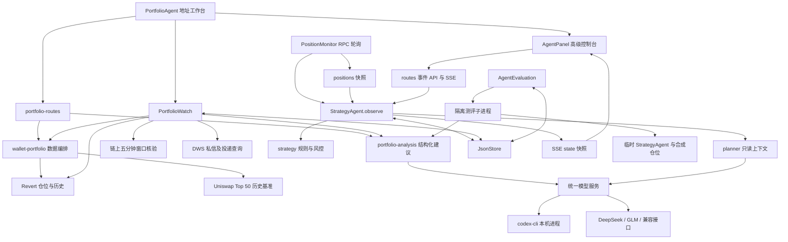
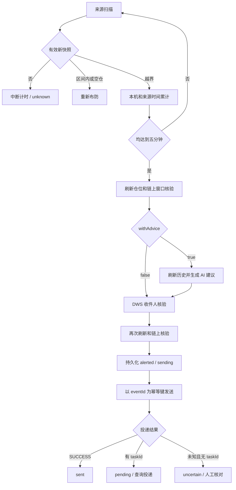

# LP Agent 运行逻辑与架构

> 整理时间：2026-11-09（北京时间）。依据当前工作区源码，包含工作区尚未提交的地址监控、独立 worker 和测评模块。本文是源码架构说明，不代表服务正在运行、相关能力已经部署或外部调用已通过验收。

## 1. 当前 Agent 由哪些部分组成

当前产品主入口是地址工作台 [PortfolioAgent](../../src/portfolio-agent.tsx)。运行时有三条业务链路，另有独立测评入口；它们没有统一的任务队列或交易执行器。

| 链路 | 输入与触发 | 输出 | 状态位置 |
| --- | --- | --- | --- |
| 地址查仓与按需分析 | 输入地址、选择仓位、点击分析 | 刷新后的仓位快照和 AI 建议 | 页面内存；IndexedDB 只保存地址；服务端临时缓存 |
| 地址持续监控 `PortfolioWatch` | 用户开启后，约每 30 秒扫描 | 连续越界确认、可选 AI 建议、钉钉私信及投递状态 | JSON 的 `portfolioWatch` |
| 事件策略 `StrategyAgent` | 已导入仓位快照变化、手动评估、合成演练 | 规则/模型计划、独立风控、成本模拟和复盘 | JSON 的 `agent` |
| 质量测评 `AgentEvaluation` | 本地页面点击测评，经 API 显式启动 | 合成场景结果、分维度评分、改进建议 | JSON 的 `evaluation`；进度保存在进程内 |

地址查仓不会自动导入 `positions`，按需分析不会创建 `AgentEvent`，开启地址提醒不会切换 `AgentPolicy`。高级事件控制台位于本地页面底部的「高级：事件观察与成本演练」，展开后加载 [AgentPanel](../../src/agent-panel.tsx)。

以上模块均不签名、不广播交易。`recenter`、`reduce` 是建议动作；`simulated` 仅表示成本演练。Agent 没有调用既有钱包移除模块。

## 2. 总体架构与代码地图



### Agent 目录

| 文件 | 责任与关键入口 |
| --- | --- |
| [routes.ts](routes.ts) | 本地 Host/Origin/JSON 检查；事件 API/SSE；可选监控和测评路由；组合 `portfolioRoutes()` |
| [portfolio-routes.ts](portfolio-routes.ts) | 来源、地址分页、历史图、市场样本、AI 状态、分析；合并按需分析在途请求 |
| [portfolio-analysis.ts](portfolio-analysis.ts) | 提供方选择、事实裁剪、提示词、schema 和输出校验；导出 `portfolioAgentDefinition` 供测评使用 |
| [codex-cli.ts](codex-cli.ts) | CLI 安装/登录检查、隔离调用、输出事件检查、临时文件清理 |
| [portfolio-watch.ts](portfolio-watch.ts) | 扫描、连续越界计时、链上确认、自动分析、提醒投递和重试 |
| [runtime.ts](runtime.ts) | `StrategyAgent` 生命周期、持久事件队列、计划、重启恢复和模拟；导出默认策略 |
| [strategy.ts](strategy.ts) | 行情上下文、候选策略、规则建议、确定性风控和设置校验 |
| [planner.ts](planner.ts) | 准备只读证据并校验模型动作 |
| [model-config.ts](model-config.ts)、[model-service.ts](model-service.ts) | 本地模型配置、统一结构化调用与用量记录 |
| [evaluation.ts](evaluation.ts) | `AgentEvaluation` 报告生命周期、子进程启动、IPC 进度/结果、重启中断恢复 |
| [evaluation-cases.ts](evaluation-cases.ts) | 合成场景、评估维度、根据当前提示词选择案例、定义指纹 |
| [evaluation-worker.ts](evaluation-worker.ts) | OpenEvals 编排；调用真实建议函数、隔离事件场景和 Codex 评审 |

### 模块外的连接点

| 文件 | 作用 |
| --- | --- |
| [server/index.ts](../index.ts) | 本地完整运行时组装与启动 |
| [server/store.ts](../store.ts) | `AppData`、串行更新与 JSON 原子替换 |
| [server/monitor.ts](../monitor.ts) | 更新已导入仓位，每轮结束唤醒事件 Agent；保留旧价格预警 |
| [shared/agent.ts](../../shared/agent.ts)、[shared/portfolio.ts](../../shared/portfolio.ts)、[shared/evaluation.ts](../../shared/evaluation.ts) | 事件、地址仓位/监控、测评的共享契约 |
| [wallet-portfolio.ts](../services/wallet-portfolio.ts) | 地址/来源校验，仓位刷新、股票身份、历史与市场基准组合 |
| [revert-portfolio.ts](../services/revert-portfolio.ts) | Revert 分页、单仓位读取、归属校验、收益和历史映射 |
| [portfolio-exit-confirmation.ts](../services/portfolio-exit-confirmation.ts) | 五分钟池价、Swap 日志和链头一致性复核 |
| [dws-auth.ts](../services/dws-auth.ts)、[dws-notifier.ts](../services/dws-notifier.ts) | 当前用户和收件人核验、消息发送、投递查询 |
| [local-codex-bridge.ts](../local-codex-bridge.ts) | 4318 桥接、最小实际调用验证、会话令牌和来源限制 |
| [portfolio-worker.ts](../portfolio-worker.ts) | 无 HTTP 服务的独立监控进程，跳过 AI |
| [api/index.ts](../../api/index.ts) | 云端仅挂载 portfolio router |

## 3. 启动顺序与运行形态

本地 `server/index.ts` 的启动顺序：

1. 加载 `JsonStore`，默认 `data/lp-sentinel.json`，可由 `LP_SENTINEL_DATA_FILE` 覆盖。
2. 创建 `AgentEvaluation`，把上次遗留的 running 测评标记为 interrupted，不自动重跑。
3. 启动 `StrategyAgent`：恢复中断事件、观察一次、设置五秒定时观察并消费队列。
4. 启动 `PortfolioWatch`：处理未知投递状态、设置三十秒定时器；仅在持久配置 enabled 时查仓。
5. 启动 `PositionMonitor`，每轮结束调用 `agent.observe()`。
6. 挂载路由，在 `127.0.0.1:4317` 监听；端口可由 `LP_SENTINEL_PORT` 覆盖。

```sh
npm run dev          # API 4317 + Vite 1422
npm start            # 本地后端；NODE_ENV=production 时提供已有 dist
npm run codex:bridge # 独立本机 Codex 桥接
npm run watch:worker # 独立 Linux 地址监控，需要预先准备运行条件
```

| 入口 | 持续任务 | AI 能力 | 持久状态 |
| --- | --- | --- | --- |
| 本地完整后端 | PositionMonitor、StrategyAgent、已启用的 PortfolioWatch | Codex、DeepSeek、GLM 或兼容接口；事件模型另行启用 | 本地 JSON |
| 4318 桥接 | 无仓位监控 | 本机 Codex 按需分析 | 连接状态、PID 文件；无业务 JSON |
| Vercel `api/index.ts` | 无持续监控、事件队列或测评 | 代码支持 Gateway；仓库 `vercel.json` 设置 provider=disabled | 无本地业务持久化；实例内缓存 |
| 独立 `portfolio-worker.ts` | 仅 PortfolioWatch | `withAdvice=false`，只发送提醒 | 指定持久 JSON |

`VITE_LP_RUNTIME=cloud` 隐藏本地状态、监控设置和高级控制台。云端页面仍可将用户点击的分析发送到同机 4318，不会把本地后台任务迁移到云端。

独立 worker 要求：已有且可读写、已启用监控的绝对路径 `LP_SENTINEL_DATA_FILE`，Linux `flock`，以及可核验收件人的 DWS 登录。检测到 `VERCEL_REGION` 时拒绝启动。锁只约束使用同一锁文件的 worker；本地主服务不获取这把锁，不能与 worker 同时写同一文件。

浏览器恢复 IndexedDB 地址只填输入框；持久化监控若已启用，则会随本地服务恢复，与浏览器是否打开无关。

## 4. 地址查仓与按需分析

### 查询及事实准备

1. 用户查询时保存地址，前端并发读取七个来源，每个来源内部按游标串行翻页。停止或切换查询使用 AbortController 和查询代次过滤迟到结果。
2. `GET /api/agent/wallet/:address` 经地址和来源校验后调用 `readWalletPortfolioPage()`。
3. 当前发现路径使用 Revert：Robinhood、Base、Ethereum、Arbitrum、Optimism 的 Uniswap V3，BNB 的 PancakeSwap V3，以及 Base Aerodrome CL。它与旧 NFT 导入的 RPC 适配器注册表分开。
4. Revert 映射检查网络、协议、仓位未退出和 `real_owner ?? owner`。key 包含来源、revert、协议及 NFT ID。当前映射返回集中仓位；类型保留 classic 不代表该发现接口返回普通池。
5. 分析请求仅接受 `{ address, sourceId, positionKey }`，服务端重新读取指定 NFT 并核对归属，不接收浏览器价格或资产金额。
6. `refreshPortfolioPosition()` 拒绝过期标记、超过 180 秒或未来超过 5 秒的快照，补充股票代币身份、个人历史和 Uniswap Top 50 参考。具体缺口保留在 status、notes、warnings 中。

个人历史包括近三十天仓位快照、手续费/奖励、现金流、区间活动，以及池级成交量/费用/TVL。完整日收入和池历史按 UTC 日处理，区间活动图按北京时间分天。采样占比、精确回放时段、未知和未持仓时段不能混为真实收益。

### 提供方、输出和并发

地址分析、自动提醒和事件策略共享本地选中的模型配置；默认 Codex，也支持 DeepSeek、GLM、OpenAI 兼容接口，保留旧 Gateway 环境兼容。前端在本地选择远程模型后不会静默回退到 Codex。普通后端的 Codex available 只检查可执行文件和登录状态，缓存三十秒；远程模型 available 只检查配置，不保证实际调用成功，可主动运行连接测试。Vercel 保持 disabled。

模型事实不直接携带钱包地址、仓位 key、池地址及 token 合约地址；包含网络、协议、数量、区间、质押状态、收益、历史、现金流和限制。时间图中的 positionKey 被去除，token 文本和 notes 被声明为数据。

输出经过 schema 和运行时双重校验：提供保守、激进两种方案，各自包含动作、简短建议、策略和触发条件；当前出区间的集中仓位不能两个方向均只持有。旧的 action、strategy、trigger 保留为保守方案，兼容既有提醒记录。普通池拒绝 recenter，空仓位只接受 hold，并由服务端将两套方案限定为观察后续状态。数据过期时不分析。服务端按实际数据另补缺口、未来成本报价不可判断和已出区间风险；自动提醒展示两个方向。这不是未来收益预测，返回分析所用完整 snapshot。

每个 router 用 Map 合并相同「地址 + 仓位键」的在途请求，已有两个不同请求时拒绝新任务（429）。这是实例内限制，不覆盖 Watch、测评或其他服务进程。按需结果保存在页面内存，不进入 AgentState。

### 模型路径

| 路径 | 运行方式与约束 |
| --- | --- |
| AI SDK 兼容接口 | 单次结构化 JSON 请求，六十秒超时；本地明文密钥文件权限 0600，可选环境变量；输出再本地校验 |
| Codex | 独立临时目录，ephemeral、忽略用户配置、只读沙箱、结构化输出；关闭命令、插件、浏览器、多 Agent、hooks、记忆及网页搜索等能力；九十秒超时 |

Codex 必须出现 turn.completed，且无 turn.failed、未恢复错误或命令、MCP、网页搜索、文件修改事件，否则拒绝结果。完成之前已恢复的 Reconnecting 中间事件不视为最终失败。临时文件最终清理；设置页可选 CLI 模型。数据、模型或校验失败明确返回错误，不伪装为分析成功；浏览器取消也不保证服务端已发起的调用立即终止。

### 4318 连接验证

桥接仅监听 loopback，校验 Host 和明确 Origin 白名单；修复和分析 POST 需要进程内 `X-LP-Bridge-Token`，JSON 限制 16 KB。阶段为 checking、missing-cli、needs-login、error、ready。

ready 要求可执行、已登录、最小 JSON 实际调用成功。状态读取不调用模型；[启动脚本](../../scripts/start-local-codex.mjs)和显式修复触发验证。后续调用失败会使下一次状态检查转为 error。它比普通后端 available 严格，但不保证下一次建议一定成功。

## 5. 地址持续监控 PortfolioWatch

### 扫描与越界计时

| 参数 | 当前值 | 含义 |
| --- | --- | --- |
| INTERVAL | 30 秒 | 各来源独立扫描，正在读取的来源跳过本轮 |
| MAX_GAP | 90 秒 | 有效观测最大间隔 |
| CONFIRM | 300 秒 | 本机时间和来源时间均须跨过的确认时长 |
| RETRY | 60 秒 | 可重试处理或投递查询间隔 |
| 来源分页上限 | 100 页 | 超限视为失败，不以部分结果完成扫描 |
| jobs 并发 | 2 | 确认、分析与通知处理任务 |

每轮绕过普通分页缓存。来源失败、分页 warning、仓位消失、数据过期、价格与状态不一致、来源时间倒退或观测中断，会打断计时。缺失数据不能作为持续越界证据。

首次有效越界记录本机 outsideSince、来源 snapshotSince 和新 eventId。只有本机经过五分钟、来源时间也前进五分钟，才设置 confirmedAt。相同来源时间不累加进度；confirmedAt 只是获得后续链上核验资格。

有效区间内或空仓位会清除本轮状态并重新布防。停止、切换地址、重新配置时更新 sessionId；异步写回同时核验 sessionId 和 eventId，防止旧结果覆盖新会话。



### 链上复核的精确含义

`confirmPortfolioExit()` 把价格上下界还原为 tick 并检查精度，核对 chain ID、池 token 顺序和区块。链头时间须覆盖观察起点之后五分钟，随后定位**链头之前最近五分钟**的窗口。

读取窗口起点之前和链头的 slot0，两者必须在区间外同一侧；分块查询并排序 Swap 日志，任一 tick 回到 `[lower, upper)` 或跨到另一侧都拒绝确认。最后要求回放终点 tick 匹配链头，并再次核对链头 hash。

因此它不是从 outsideSince 开始无限回放历史，也不是链最终性证明。它核验最近五分钟池价；仓位归属与有效性仍依赖刷新的索引事实。RPC 不可用、事件不完整或核验失败时不发送。

### AI 与投递恢复

本地服务默认 withAdvice=true：初次核验后刷新历史、生成并保存 WatchAdvice；发送前再次读取最新仓位并链上复核。历史刷新整体失败时可退回最新单仓位事实，并标注限制；AI 不可用或调用失败则等待重试，不自动降级为纯提醒。独立 worker 的 withAdvice=false 跳过模型，仅发送状态、价格和区间。

通过 DWS 当前组织/用户核验收件人并绑定 deliveryProfile；先保存 alerted=true/sending，再发私信。此路径不读取旧监控的 dingEnabled/dingCallEnabled，也不追加电话 DING。

| delivery | 意义 |
| --- | --- |
| none | 未开始或已重新布防 |
| waiting | 等待处理或前置步骤重试 |
| analyzing | 正在生成建议 |
| sending | 已记录发送意图，正在请求 DWS |
| pending | 有任务 ID，但尚未确认投递 |
| sent | 仅在 sendStatus=SUCCESS 时标记 |
| uncertain | 结果未知，需要查询或人工核对 |

有 taskId 时只查询投递状态，且须保持同一 DWS 身份；alerted 且无 taskId 时不会自动重发，即使存在 retryAt。重启遇到 sending 且无 taskId 时改为 uncertain。普通处理失败可六十秒后重试，没有统一最大次数；同一轮越界发送后不再提醒，回区间后才重新布防。

## 6. 事件策略 StrategyAgent

### 上下文与事件来源

StrategyAgent 消费 PositionMonitor 保存的快照，不直接发 RPC。每轮监控结束唤醒观察器，五秒定时器另负责发现过期。

`marketContext()` 分为 safe、edge、outside、unavailable：区间外优先按链上 `[tickLower, tickUpper)` 判断；区间内触及预警线为 edge；暂停、priceReadFailed、无效价格/区间、超过三十秒或未来超过五秒的快照，以及链上来源缺少 snapshot/market，都为 unavailable。

observe 的签名为 `[zone, enabled, lower, upper, source]`；价格变化相对**上次入队价格**计算。

| 事件 | 触发 |
| --- | --- |
| position.observed | 首次有效观察；首次不可用优先发 data.unavailable |
| range.changed | 区域、启停、区间或来源签名变化 |
| price.moved | 签名未变，累计价格变化至少 1% |
| data.unavailable | 变化后的上下文不可用，包括低于区块水位 |
| review.requested | 手动评估；同仓位在途任务复用 |
| demo.requested | 独立合成 ETH/USDC 越界事件，不修改真实 positions |

同状态小波动不入队；单纯新块只推进水位。入队前再次检查仓位存在、启停与价格更新时间，避免过时观察覆盖新快照。

### 队列、规划与恢复

事件状态：pending → processing → completed/failed。单实例串行消费，最多五十个在途任务；近期事件约二百条，额外保留在途记录；计划最多一百条。API 返回最近五十条事件、三十条计划，面板事件列表显示最近十条。

处理顺序：持久化 processing/attempts → 初步风控 → 规则或模型 → 用本地最新快照再次风控 → 保存计划与 trace。初检未过时使用规则；模型调用实际失败则事件 failed，不伪装为模型成功。最终检查还要求评估期间 policy、区间、区域不变，价格偏移在限制内。

| 计划状态 | 含义 |
| --- | --- |
| blocked | 任一最终检查失败 |
| observing | 检查通过且 hold |
| ready | 检查通过且 recenter/reduce，仅可进入模拟 |
| simulated | 用户提交假设成本并通过再次检查 |

规则在 outside 建议 recenter，其余区域 hold。候选始终包含 hold/recenter/reduce；居中范围按原相对半宽度估计，限制 2%–40%，没有 tick 对齐或交易报价。

重启把遗留 processing 在 attempts 小于三次时恢复 pending，否则 failed；普通分析失败不自动重跑。暂停保留队列，恢复后消费时仍检查时效。

### 模型上下文与独立风控

事件模型使用地址分析所选提供方，并需显式切换 planner=model。服务端预先整理当前行情（移除 positionId/name）、本地候选策略和最近五条决策，一次调用返回受限 action 与非空 reason；结果经本地校验与独立风控，且评估期间配置变化会阻断计划。模型没有可调用工具，不能修改风控或操作资金。「记忆」是近期记录，不是训练或自动调参。

| 策略字段 | 默认 | 允许范围 |
| --- | --- | --- |
| enabled / planner | true / rules | boolean；rules/model |
| cooldownSeconds | 900 秒 | 整数 60–86400 |
| maxCostBps | 30 bps | 整数 1–500 |
| maxPriceDriftBps | 100 bps | 整数 1–1000 |

基础风控检查 Agent/仓位启用、三十秒时效、价格/区间/本金有效、模拟冷却。DWS 通知失败不等于 priceReadFailed，不会单独阻止有效行情的策略分析。

### 成本模拟

仅接受 `{ gasQuote, slippageBps }`；Gas 为有限非负数，滑点为 0–500 bps。仅 ready 可模拟，重复模拟已 simulated 计划返回原结果。

模拟前重新读取本地最新快照，检查区块水位、区间/区域、价格偏移、启用状态和冷却，计划年龄不能超过一百二十秒。

```text
estimatedCostQuote = gasQuote + valueQuote × slippageBps / 10000
costBps = estimatedCostQuote / valueQuote × 10000
valueAfterCostsQuote = valueQuote - estimatedCostQuote
```

成本超过上限则拒绝；通过后 simulation 与 lastSimulatedAt 在同次 JSON 更新中提交，并写 paper.executed/memory.updated。不修改原仓位，不计未来手续费、价格、无常损失、MEV 或真实成交。合成演练也受三十秒快照限制，二分钟计划上限不能延长其快照有效期。

## 7. 当前新增的质量测评模块

本节记录当前工作区实现；实际运行和验收以最新测评报告为准。

本地工作台挂载 [AgentEvaluation 面板](../../src/agent-evaluation.tsx)。点击「开始测评」调用 POST /evaluation；running 时每 2.5 秒轮询状态，展示场景进度、雷达图、评分依据和改进建议。未评分维度保留为空，不用零分补齐雷达多边形。云端构建不展示此面板。

`AgentEvaluation.start()` 检查无正在运行任务及 Codex 安装、登录与隔离能力，复制当前成本/冷却/漂移策略，但强制 enabled=true、planner=rules。保存 running 报告后 fork evaluation-worker.ts，以 IPC 接收进度和最终结果。进度保存在内存，开始/结果落 JSON；重启将未完成报告转为 interrupted。

测评使用 LangChain OpenEvals 0.2.3，并发二；模型评审使用本机 Codex，事件断言使用确定性匹配，LangSmith 跟踪关闭。事件场景放入临时目录，worker 强制地址分析 provider=codex，不启动真实 PositionMonitor 或 PortfolioWatch。

| 场景组 | 当前案例与验证方式 |
| --- | --- |
| 建议质量 | 越界、历史缺口、池级基准与有效时间、质押普通池、空仓、股票代币、数据内指令注入；合成 PortfolioPosition 调用真实 analyzePortfolioPosition |
| 事件风控 | 越界、过期、读取失败、冷却、成本超限、价格漂移；临时 JsonStore + StrategyAgent 调用 review/simulate；地址提醒验证五分钟采样、重计时与合成 Swap 回放 |

案例目录当前十七项，部分建议案例根据当前提示词是否包含对应约束选择。定义指纹对 instruction、schema、策略核心实现、policy 和所选案例做 SHA-256，用于标识本轮定义；它不是全仓库代码指纹。

七个维度为输出契约、事实依据、风险识别、建议可执行性、指令边界、事件响应、风控拦截。契约与事件/风控用确定性断言；建议质量由另一次 Codex 调用评分 0–4，再映射 0/25/50/75/100，75 为通过门槛。未完成项记 null，不计入维度均分；报告 completed 仅表示框架结束，案例仍可能 failed/incomplete。

这里会真实调用模型，但输入是合成场景，不调用真实 RPC、不发通知、不交易。建议生成与评审都用 Codex，存在同类模型偏差；分数不代表投资收益，也没有自动修改提示词、策略或生产设置。与 server/research 的离线历史研究是不同入口。

## 8. 状态、接口和配置

### 持久化及刷新方式

| 状态 | 保存内容 | 更新方式 |
| --- | --- | --- |
| positions | 旧导入仓位、链上快照、历史和告警状态 | PositionMonitor + JSON |
| agent | policy、events、plans、observed、lastSimulatedAt | JSON；EventEmitter 推 SSE |
| portfolioWatch | 地址、sessionId、来源结果、仓位计时/建议/投递状态 | JSON；页面十五秒轮询 |
| evaluation | 最近一份测评报告 | 开始/结束持久化，过程进度在内存 |
| IndexedDB | lp-sentinel/preferences/wallet-address | 主动查询保存，仅恢复输入 |
| React/Map/Set | 按需建议、缓存、在途请求、扫描与任务锁 | 页面或进程生命周期 |

JsonStore 返回深拷贝，update 通过 Promise 队列串行处理；先写 `.tmp` 再 rename，成功后发布内存状态。单实例写入不会因写盘失败留下未持久化的成功状态，但不支持跨进程事务或消费者租约。

SSE 发送完整 AgentView，初次连接/重新连接返回当前快照，十五秒心跳；它不是可按事件 ID 补发的增量事件日志。GET /api/state 排除 agent、portfolioWatch 和 evaluation。

### API

下表路径前缀均为 `/api/agent`。通用接口指本地和云端 portfolio router；桥接另外限制为仅 analyze。

| 方法 | 路径 | 入口/用途 |
| --- | --- | --- |
| GET | /sources | 通用，来源列表 |
| GET | /wallet/:address?sourceId=&cursor= | 通用，分页查仓 |
| GET | /ai-status | 通用，配置或 CLI 状态 |
| POST | /analyze | 通用及桥接，刷新事实后分析 |
| GET | /range-activity?address=&sourceId=&positionKey= | 通用，时间图；可选 refresh=1 |
| GET | /pool-universe | 通用，Top 50 历史样本 |
| GET / POST | /portfolio-watch | 本地，状态/启停/换地址/清除 |
| GET | / | 本地，AgentView |
| GET | /stream | 本地，SSE state |
| PATCH | /policy | 本地，部分更新策略 |
| POST | /review/:positionId、/demo | 本地，事件入队，202/eventId |
| POST | /plans/:planId/simulate | 本地，成本模拟，冲突返回 409 |
| GET / POST | /evaluation | 本地，读取/启动测评，启动 202，冲突 409 |

监控 POST 接受 `{ enabled: true, address }`、`{ enabled: false }` 或 `{ enabled: false, clear: true }`。桥接另提供 `/api/local/status`、`/api/local/repair`。

本地 Agent 路由检查 loopback Host，写请求要求 JSON 并校验 Origin；云端按 Vercel Host 配置和 HTTPS 同源检查。没有通用多用户账户和权限体系。

### 关键配置

| 配置 | 作用 |
| --- | --- |
| LP_SENTINEL_DATA_FILE / LP_SENTINEL_PORT | 本地文件和端口；独立 worker 文件必须为绝对路径 |
| LP_PORTFOLIO_AI_PROVIDER | 默认 provider；disabled 强制关闭模型 |
| LP_CODEX_BIN | CLI 路径，默认 codex |
| DEEPSEEK_API_KEY / ZHIPU_API_KEY / LP_COMPATIBLE_API_KEY | 未在设置页保存密钥时的环境变量来源 |
| LP_AGENT_MODEL_CONFIG_FILE | 可选模型配置路径，默认数据目录的 agent-models.json |
| AI_GATEWAY_API_KEY / LP_AGENT_MODEL | 旧 Gateway 环境兼容配置 |
| VITE_LP_RUNTIME=cloud | 前端构建时隐藏本地专属能力 |
| 各链 *_HISTORY_RPC_URL / *_RPC_URL | 历史及越界复核，复核优先历史 RPC，再实时 RPC，再默认值 |

普通 npm run dev 后端不自动读取 `.env`；环境变量由进程环境提供，或使用 `node --env-file=.env --import tsx server/index.ts`。本文不记录实际凭据、钱包或账户数据。

## 9. 架构限制与文档差异

1. **不同链路的风控独立。** 地址建议经过格式、类型和上游事实校验，但不经过事件策略的成本/冷却/价格漂移检查。自然语言 trigger 不是可执行门禁。
2. **容量和成本没有全局协调。** 事件队列、按需分析、Watch、测评可同时调用模型；各自并发限制不构成全局限流或预算控制。
3. **停止不等于撤回。** 主要停止后续调度和写回，已发 RPC/模型/DWS 调用不都立即取消；已发消息不能被停用操作撤回。桥接退出会终止它追踪的 Codex 子进程。
4. **单文件需要单个所有者进程。** 原子替换不是跨进程锁；本地主服务不能与 worker 同时写一个文件。Watch 历史仓位记录也没有事件队列那样的固定条数裁剪。
5. **通知存在两条独立路径。** 旧 PositionMonitor 的预警线通知与 Watch 五分钟提醒没有共享去重；关闭 StrategyAgent 不会停止这两套通知。
6. **外部证据有限。** 索引当前快照可能无可核验区块号，日志复核依赖 RPC 完整性；链头 hash 检查不保证未来不重组。当前 Top 50 回溯有选择/幸存者偏差。
7. **旧文档需按模块解释。** 根 AGENTS 的「Agent 不调用 DWS」仅适用于 StrategyAgent，PortfolioWatch 已有私信路径；当前主界面已是地址工作台。
8. **旧验收与当前 schema 可能不同。** 当前实现直接解析 key、刷新 NFT 并核对归属；历史验收输出条数不能替代当前约束。
9. **测评结论是有限合成证据。** 当前模型评审不能替代真实来源、通知送达和钱包流程验证；报告不自动应用改进，也不能当作收益承诺。

已有操作指南和历史验收见 [地址 Agent](../../docs/wallet-agent.md)、[事件策略 Agent](../../docs/strategy-agent.md)、[离线研究](../../docs/lp-research.md)。这些历史记录不视为本次验证结果。
